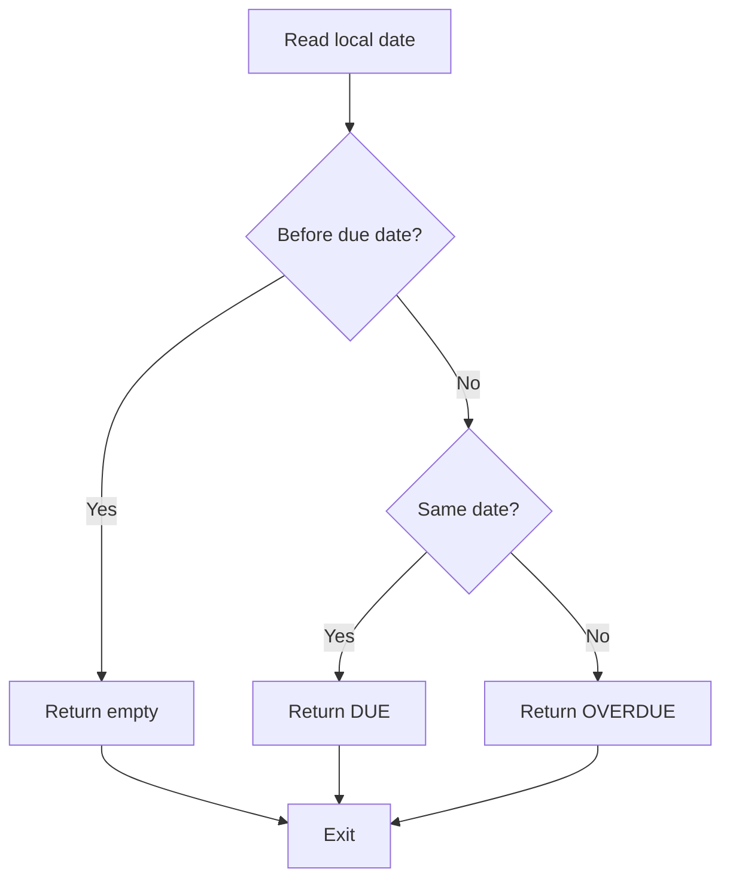

# GIKI Digital Mess Management System
## Milestone 2 · Menu, Smart Notifications, Feedback & Complaints

**Contribution:** Zouhair Azam Khan · SE423 / SE431 · 18 November 2026
**Branch:** Menu-notifications-feedback · **Baseline:** f599d23 · **Scope change:** Menu Management taken on at the contributor's request in addition to the M1 notification and feedback assignments. Team-wide approval of proposed refinements is outstanding.

### Build verdict

PostgreSQL 17.4 executed the production SQL for menu publication, retry, replay and escalation. A fresh backend found the committed event after the publishing backend exited. Replaying it produced one row per original student. Enrolling a later student did not deliver the historical menu to them. The same database harness verified an unsuccessful transaction leaves a draft and no event.

JDK 21.0.6 ran 30 domain and event-contract checks plus a two-worker saturation test. Chromium exercised the actual UI for staff, students, administrators and public tracking with intercepted API responses. IntelliJ coverage measured 40 of 43 instrumented lines across four source files (93.0%). The denominator covers Rules, AlertEvent, BillingAdapter and DeliveryPool. Whole-application coverage remains unmeasured.

The Spring package, live HTTP timing, JDBC concurrency tests, JaCoCo and PMD are pending. Maven was absent, its download failed DNS resolution, and the PostgreSQL TCP client was denied a loopback connection (Windows 10013). Standalone PostgreSQL and local browser fixtures enabled independent checks. No CI, team merge, push, Fagan inspection, staff resolution-time study or 500-user certification took place.

**Demo entry point.** In PowerShell 7, run `pwsh -File scripts/demo.ps1 -Action Verify`, then `pwsh -File scripts/demo.ps1 -Action Run` from the checkout. Open http://127.0.0.1:8080. Use the printed demo password for staff and student in separate browser sessions. Create a draft, publish it and replay the event; the student's matching menu and one inbox row are the acceptance criteria. The full complaint, administrator and billing walkthrough is in docs/m2/RUNBOOK.md.

### Requirements traceability · RTM v2 contribution

| M1 requirement / test group | Implemented behavior and test inputs | Actual result and open verification |
|---|---|---|
| MENU-01 / MN-01 | Filter by date and BREAKFAST, LUNCH or DINNER. Drafts are staff-only. | PostgreSQL draft/published query passed. UI fixture passed. Actual MVC role matrix pending in PortalAccessTest. |
| MENU-02 / MN-02 | Validate slot and dishes. Update where ID and version match. Publish and outbox insert share a transaction. | Stale write rejected by SQL. Commit, rollback and restart passed. Two simultaneous Spring editors specified in PostgresBehaviorTest, pending execution. |
| FR-011 / NT-02 | Bill, menu and announcement events feed the inbox. Key is (event ID, student ID). | PostgreSQL publish/replay and injected failure/retry passed. Producer/worker Java checks passed separately. 60-second end-to-end target open. |
| ALERT-01 / NT-03 | Clock-controlled due/overdue transitions, special meal on publication, duplicate-safe reminders. | Before/on/after local midnight and bill ID/time translation passed. JUnit special meal, settlement and scheduled reminder transaction tests pending. External bill producer is a fixture. |
| FR-004 / NT-01 | Proposed reminder 30 min before meal cutoff. | Deferred pending baseline approval and an authoritative cutoff producer. |
| FR-008 / FB-01 | Anonymous case data, random reference, public status projection, staff transitions and resolution time. | Java transition checks and SQL resolution timestamp passed. Browser submit/track fixture passed. Full HTTP disclosure and access tests pending. Human 48-hour resolution target open. |
| QA-COMP-01 / FB-02 | Eligible complaints escalate once at age ≥ configured threshold. Feedback, resolved and closed cases excluded. | PostgreSQL just-before, exact, repeated and exclusion cases passed. Overlapping JDBC job test pending. Proposed default 48 h. |
| RATING-01 / FB-03 | Integer 1–5 inclusive on a published menu. No student ID in rating storage. | Java and PostgreSQL boundaries passed. Student rating control passed in Chromium fixture. |
| QA-03 / QT-03; QA-05 / QT-05; QA-06 / QT-06 | Capacity, access control and usable role workflows. | Small SQL workload measured. MVC identity matrix pending. Keyboard publish, stale error focus and 390 px workflows passed with fixtures. WCAG AA, user trials and 500-user mixed load open. |
| QA-07 / QT-07; QA-08 / QT-08; QA-10 / QT-10 | Maintainable components, persistent records and compatible event replay. | Scoped compiler analysis and PostgreSQL restart/replay passed. Teammate producer integration and deployment recovery remain open. |

### Architecture and integration contracts

| Boundary | Contract and integration evidence |
|---|---|
| Menu → notifications | Menus orchestrates validation and the transaction. MenuRepository performs versioned writes. EventPublisher persists an immutable AlertEvent containing UUID, occurrence instant, kind, audience and public summary. Publishing a special meal creates one SPECIAL_MEAL event. Editing an already published slot creates a new revision event. Date and meal identify the slot. |
| External billing → application | Verified Billing&PaymentSystem at 934aa9d. Its POM uses Java 22, plain Maven and SQLite. BillingPaymentModule wires AttendanceSubject to BillingObserver. Bill holds a string bill ID, student ID, due date and payment status. The inspected composition root exposes no outgoing alert publisher. BillingAdapter translates only the provisional BILL_ISSUED envelope, preserving event UUID, Instant and student ID. Other wire kinds are rejected. |
| Reminder policy | BillReminders.issued accepts the translated event, producer bill ID and due date. Its local reminder cursor is separate from the ledger. Settled facts cancel pending reminders, including settlement before issuance. On the due date, emit DUE once and schedule the next local midnight. After that date, emit OVERDUE once. A late first poll emits the currently applicable kind. The publisher must supply immutable issuance facts and eventual settlement. |
| Identity and roles | Login-/-Mess-in/out points to f599d23, the same README-only commit as this branch's initial tree. No shared auth implementation was present there. Provisionally the principal name equals campus_student.id. Spring Security enforces STAFF/STUDENT/ADMIN by URL. The inbox query takes only the authenticated principal. Fixtures and demo sign-ins use the demo profile. |
| Async subscription | Delivery invokes an injected AlertSubscriber. PostgresInbox persists receipts using a unique composite primary key. The pure BillingAdapter performs no I/O or service calls. An eventual cross-process producer needs a durable transport with acknowledgment after local commit; a lost upstream fact cannot be recovered locally. |
| Feedback privacy | Random UUIDv4 reference is the public lookup capability. Case/rating schema has no submitter ID. Tracking uses POST and returns status, escalation flag and timestamps. Staff and admin views include private case text only behind their respective role checks. No complaint body enters an alert. The live privacy matrix is pending. |

### Concurrency, recovery and performance

Menu writes take one compare-and-set update. The winning transaction commits the menu revision and outbound fact together. No callback runs in the request thread. Event UUID collisions are accepted only for the same payload after timestamp normalization to PostgreSQL microseconds.

Each instance has two worker threads, zero in-memory queue and at most eight claims per drain. Saturated offers leave rows pending for the next poll. A worker locks one eligible row with FOR UPDATE SKIP LOCKED. A nested savepoint rolls back failed inbox writes while the outer transaction retains its claim and records retry state. Backoff is 1, 2, 4 and 8 seconds before the fifth failure goes to DEAD. Logs contain event ID, attempt and state. Process loss rolls back the active batch; committed progress and pending events survive restart.

Broadcast scans up to 128 student IDs per transaction. A keyset cursor commits with receipts; enrollment time excludes students who joined after the event. Targeted delivery uses the recipient foreign key. The inbox query joins event and receipt in one statement. Public lists use 20 rows per page. Reminder and escalation claims are capped at 32 and 64. Partial indexes support ready work, due reminders and eligible complaints. Escalation and status changes contend on the case row; escalated_at records the first escalation and remains visible as history after resolution.

| Measured workload | Throughput | p95 | Errors |
|---|---:|---:|---:|
| PostgreSQL 17.4 standalone, 1 backend, 2,000 hot inbox lookups, 3 stored receipts, one matching student row | 22,477.7 SQL reads/s | 0.021 ms | 0 |

Timing used clock_timestamp around the lookup inside PL/pgSQL. Throughput is count divided by summed lookup time. The benchmark excludes network, authentication, request handling, client waits and table population. A 60-second trigger-to-inbox observation and multi-client HTTP workload are available in scripts/http-check.py. Both need the running Spring build. The 500-user quality target requires an agreed dataset, workload mix and deployment.

### Black-box design · equivalence partitions and boundaries

| Input / requirement | Representatives and expected result | Evidence |
|---|---|---|
| Dishes/message · MENU-02, FR-008 | Null, blank, NUL and too long reject. Trimmed length at limit accepts. A private NUL-bearing message once passed validation. | DomainChecks reproduced the defect and passed after correction. |
| Day, meal and slot · MENU-01/02 | LUNCH valid, SNACK invalid, matching draft hidden, published visible, missing slot empty. Same version succeeds once, stale version conflicts. | Java meal checks, shared SQL, UI conflict fixture. Duplicate slot DB uniqueness; Spring role and race tests pending. |
| Due time · ALERT-01 | Karachi local midnight −1 ns: no alert; midnight: DUE; following midnight −1 ns: DUE; following midnight: OVERDUE. | All four fixed-clock checks passed. |
| Rating · RATING-01 | Below: −1/0; valid: 1/3/5; above: 6. Draft menu cannot receive a rating. | Java 6 inputs passed, SQL 0/1/5/6 passed. Published-menu predicate in rate_meal.sql. |
| Age/status · QA-COMP-01 | Just before threshold, exact threshold, repeat after threshold. Open complaint eligible; feedback, resolved and closed excluded. | Standalone SQL passed; JUnit exercises same threshold and simultaneous jobs. |
| Tracking · FR-008 | Valid reference returns minimal status. Unknown valid UUID returns 404, malformed input 400. Open → resolved skip invalid; open → in review → resolved → closed valid. | Domain transition suite, SQL resolution and browser fixture passed. Server response/role suite pending. |
| Page · shared lists | −1 rejects; 0 is first; 10,000 accepted; 10,001 rejects. | Four JDK checks passed. |

### White-box design · dueKind

Rules.dueKind first obtains the local calendar date from the supplied Clock. Two binary decisions produce three independent paths. Counting a single exit gives seven nodes and eight edges, so V(G) = 8 − 7 + 2 = 3.

| Basis path | Example for due date 18 November 2026, Asia/Karachi | Observed |
|---|---|---|
| A–B–C–G | 17 Nov at 23:59:59.999999999 | Empty |
| A–B–D–E–G | 18 Nov at 00:00:00 | DUE |
| A–B–D–F–G | 19 Nov at 00:00:00 | OVERDUE |

### Static analysis, defects and SCM

JDK javac parsed all 30 application/test Java sources. The dependency-free domain, contracts and worker pool compiled with -Xlint:all -Werror. JDK jdeprscan reported no deprecated Java SE usage in those compiled classes. Node accepted app.js syntax. Full dependency resolution and Spring type checking remain pending. Pylint ran E/W checks on both Python verification scripts. Its five initial warnings were triaged and fixed; the rerun found zero. The Java PMD report is pending the Maven build.

| Finding / source | Correction and disposition |
|---|---|
| CAPA-01 · Java text validator accepted NUL | Added a failing behavior assertion, rejected NUL before persistence and reran the Java suite. Closed for the tested input. |
| CAPA-02 · W0718 in HTTP benchmark | Narrowed exception handling to transport and value/decoding failures so programming mistakes fail the check. Closed by Pylint rerun. |
| CAPA-03 · W1510, W1309, W0621 ×2 in test scripts | Made manual subprocess return-code handling explicit, removed unnecessary f-string prefix and renamed per-client counters. Closed by Pylint rerun. |
| Integration gate | Maven bootstrap DNS failure, local TCP denied. Run Verify, triage PMD, exercise the HTTP walkthrough and retain real reports before merge. Open. |

The local history begins at f599d23. b15d551 records failing specifications, 1ef8a46 records the first implementation and passing domain output, 125c8a1 → 9b0e7c2 records worker extraction, and validation-red/green captures a behavioral regression. Run git log --oneline origin/Menu-notifications-feedback..HEAD and git show for individual changes. Raw outputs are in docs/m2/evidence. The CI workflow is prepared for a future push/PR. Branch protections, external review and successful CI runs have not been verified.

### Risk register · 18 November review

| M1 risk / owner | P × I; status | Mitigation evidence and residual exposure |
|---|---|---|
| R-04 incorrect menu · Zouhair for this contribution; M1 owner Bareera | 3 × 3 = 9, medium; open | Atomic version comparison, role rules and stale SQL passed. Concurrent JDBC and joint ownership confirmation pending. |
| R-05 missed/repeated alerts · Zouhair | 3 × 4 = 12, high; open | Restart, dedup, forced retry and thread saturation exercised. Live producer transport, JDBC overlap and end-to-end latency pending. |
| R-06 privacy/escalation · Zouhair | 3 × 4 = 12, high; open | Identity-free schema, minimal tracking projection, threshold/exclusion tests. Shared authentication, deployment log review and staff resolution SLA pending. |
| R-07 scope/capacity · Zouhair | 4 × 5 = 20, high; open | Three role workflows implemented. FR-004 deferred. Small database measurements leave the 500-user mixed workload and team-wide coverage open. |
| R-08 integration/evidence · Bareera; Zouhair for SQA | 3 × 4 = 12, high; open | Billing and auth branches inspected. Local red/green history and test evidence retained. A team-integrated build and external inspection remain outstanding. |

### Verification, validation and AI usage

| Activity | Responsible party and timing | Evidence / acceptance |
|---|---|---|
| Verify implementation against RTM | Zouhair, M2 local build and before merge | Retain raw JDK/SQL/browser checks, Surefire, JaCoCo, PMD and live HTTP results. Resolve failed checks before claiming a verified build. |
| Verify integration contracts | Mahvash with Zouhair for billing; Bareera with Zouhair for identity, before integration | Agree on identifiers, authoritative issuance/settlement, durable acknowledgment and roster mapping. Replay producer fixtures against both sides. |
| Validate usefulness with intended users | One student, mess staff member and admin with Zouhair before M3 | Observe unassisted browse/publish/track/resolve/escalation tasks, record success, errors, time and feedback. Verify keyboard use and 200% text resize on real tasks. |
| Validate quality targets | Team on agreed deployment, before M3 | Record end-to-end alert latency, ≥500-user workload mix, human complaint resolution times and privacy review. Keep deployment observations separate from microbenchmarks. |

**AI Usage Log.** OpenAI Codex (GPT-6), 18 November 2026. The user requested implementation, contract inspection, tests, a working demo and honest verification. Adopted material includes Java/Spring code, database schema, test harnesses, UI, launcher, CI configuration and this evidence pack. The assistant revised the text validator after a genuine failing test, extracted the worker pool and shared queries, added enrollment-aware replay, and addressed static-analysis findings. Verification is recorded above. Individual human review, explanation practice and acceptance remain with the contributor. No claim of unaided authorship or team approval is made.

**Sources.** Construction M1 proposal §§1.3–3, 5–6; SQA M1 plan §§2–4, 7; updated joint rubric §§6–9. The rubric awards 20% of the M2 SE431 team rubric to the formal inspection. It is deferred for this pass. The final ≥60% core coverage gate is an M3 requirement; M2 asks for current measured coverage.

### Concurrent access to the same record

Five rounds of five scenarios passed (25 executions) on PostgreSQL 17.4 using production SQL. Each test left one transaction prepared, preserving its database locks, then ran the competing operation in another backend. The test runner used a 300 ms lock timeout to distinguish an expected wait (SQLSTATE 55P03) from a circular deadlock (40P01), a stalled statement, or an unexpected write. The 300 ms setting applies only to this test.

| Contention scenario | Observed outcome |
|---|---|
| Two staff edit the same published menu while a student reads | The reader saw the last committed dishes. The competing write hit the held lock. After commit the old version matched zero rows and editing with the refreshed version succeeded. |
| A worker holds the oldest ready event | Another claim selected and delivered the next event. With only the locked work left, polling returned empty. Rolling back the first claim made its event claimable again. Both finished with one receipt each. |
| Two deliveries insert the same inbox receipt | The second insert waited on the uncommitted unique key. Replaying after commit inserted zero rows, leaving one receipt for the event and student. |
| Staff resolution holds the case before the escalation scan | The scan skipped that case and escalated its neighbor once. After resolution committed, the resolved case was excluded. |
| Escalation holds the case before staff resolution | A second scan skipped the held case. Resolution succeeded after the first transaction committed and retained the original escalation timestamp. |

The test checks finite progress after release. A continuously locked row can still be postponed. A prepared holder can retain a lock but cannot request a second one, so this method cannot produce a circular wait. The live JDBC suite now includes a test that observes an actual waiting editor through pg_blocking_pids and a deliberate two-row, opposite-order lock test that requires exactly one 40P01 victim and one commit. Those live tests await an environment with Maven dependencies and PostgreSQL TCP access.

**AI Usage Log update.** Codex added the held-lock scenarios, live controls and finite worker-test deadlines following the contributor's contention question. The raw PostgreSQL results are in docs/m2/evidence/record-contention.txt. No production locking or retry policy was changed in this follow-up.
