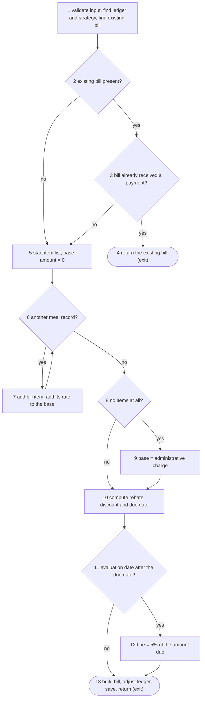
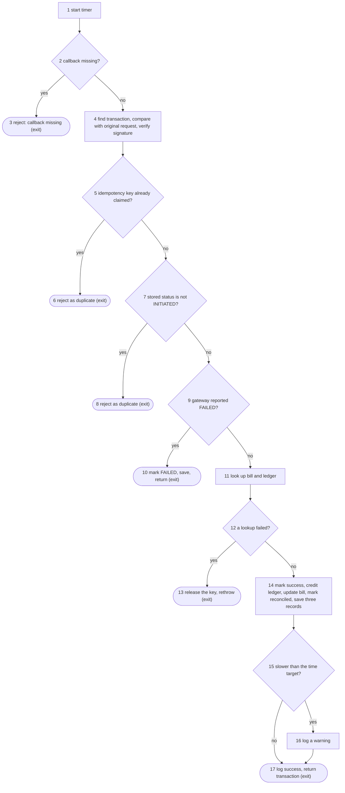

# White-Box Test Design: Control Flow Graphs, Cyclomatic Complexity, Basis Paths

SE431 Milestone 2. Owner: Mahvash Imran (2023294).
Two key methods of the Billing and Payment modules were analysed:

| Method | Why chosen | V(G) |
| --- | --- | --- |
| `BillingServiceImpl.calculateMonthlyBill` | the core billing rule (FR-002) | **6** |
| `PaymentServiceImpl.settlePayment` | the core settlement rule and duplicate protection (FR-003, QA-CONC-01) | **7** |

Executable form: `src/test/java/com/giki/mess/sqa/BasisPathBillingTest.java` (6 tests) and
`BasisPathPaymentTest.java` (7 tests), one test per basis path.

**Method.** (1) Draw the control flow graph (CFG) of the code. (2) Compute cyclomatic complexity
V(G) = E - N + 2 = P + 1 (E edges, N nodes, P decision nodes). V(G) is the number of linearly
independent paths. (3) Derive one test per independent path. (4) Show with a coverage tool that these
tests alone execute every line and branch of the method.

Both methods were first refactored under the existing test suite (tests stayed green) so that each
has V(G) <= 10, the maintainability target of the project.

## 1. `calculateMonthlyBill` (V(G) = 6)

Nodes N = 13 plus one virtual exit = 14. Edges E = 18 (16 drawn plus the two exits to the virtual exit).
Decision nodes P = 5 (nodes 2, 3, 6, 8, 11).

* V(G) = E - N + 2 = 18 - 14 + 2 = **6**
* V(G) = P + 1 = 5 + 1 = **6**
* Checkstyle `CyclomaticComplexity` (independent tool): **6**

### Basis paths and tests

| Path | Nodes | Meaning | Test (`BasisPathBillingTest`) | Observable check |
| --- | --- | --- | --- | --- |
| 1 | 1-2-3-4 | existing bill with a payment | `path1_existingPaidBill` | same object returned, no fine added, status PAID |
| 2 | 1-2-5-6-8-9-10-11-13 | no bill, no meals, on time | `path2_noMeals_administrativeCharge` | no items, base 100 PKR, fine 0 |
| 3 | 1-2-5-6-7-6-8-10-11-13 | no bill, exactly one meal, on time | `path3_oneMeal_onTime` | 1 item, base 100 PKR, fine 0 |
| 4 | 1-2-5-6-7-6-8-10-11-12-13 | meals, evaluated after the due date | `path4_lateFine` | fine 5 PKR (5% of 100) |
| 5 | 1-2-3-5-6-7-6-8-10-11-13 | existing UNPAID bill is recalculated | `path5_existingUnpaidBillRecalculated` | new bill object, 3 items, still one stored bill |
| 6 | 1-2-5-6-7-6-7-6-8-10-11-13 | loop runs more than once | `path6_severalMeals` | 3 items, base 400 PKR |

The six paths are linearly independent: each uses at least one edge no combination of the others
provides (3-4 only in path 1, 8-9 only in path 2, 11-12 only in path 4, 3-5 only in path 5, a second
traversal of 7-6 only in path 6). A "no meals and late" case is a combination of paths 2 and 4 and
needs no extra test.

## 2. `settlePayment` (V(G) = 7)

N = 17 plus one virtual exit = 18. E = 23 (17 drawn plus six exits). P = 6 (nodes 2, 5, 7, 9, 12, 15).

* V(G) = E - N + 2 = 23 - 18 + 2 = **7**
* V(G) = P + 1 = 6 + 1 = **7**
* Checkstyle `CyclomaticComplexity`: **7** (was 10 before the request comparison was extracted into
  its own method, commit `b1191b7`)

Exceptions raised inside called methods (unknown transaction, request mismatch, invalid signature) are
not edges of this method's graph; they are covered by `PaymentServiceTest` and `PaymentProcessorsTest`.

### Basis paths and tests

| Path | Nodes | Meaning | Test (`BasisPathPaymentTest`) | Observable check |
| --- | --- | --- | --- | --- |
| 1 | 1-2-3 | missing callback | `path1_nullCallback` | `InvalidCallbackException` "missing" |
| 2 | 1-2-4-5-6 | duplicate stopped by the in-memory gate | `path2_duplicateStoppedByGate` | `DuplicateTransactionException`, log "Duplicate callback ignored", ledger credited once |
| 3 | 1-2-4-5-7-8 | duplicate after a restart (gate empty), stopped by stored status | `path3_duplicateStoppedByStoredStatus` | `DuplicateTransactionException`, log "Already-settled transaction ignored" |
| 4 | 1-2-4-5-7-9-10 | gateway says FAILED | `path4_failedOutcome` | transaction FAILED, balances unchanged |
| 5 | 1-2-4-5-7-9-11-12-13 | bill missing: key released | `path5_lookupFails_keyReleased` | `BillNotFoundException`, and the same callback succeeds once the bill is back |
| 6 | 1-2-4-5-7-9-11-12-14-15-17 | normal settlement within the target | `path6_success` | RECONCILED, bill PARTIALLY_PAID, no warning |
| 7 | ...-14-15-16-17 | settlement slower than the target | `path7_slowSettlement` | RECONCILED and warning "exceeded" logged (target set to zero) |

## 3. Coverage evidence

JaCoCo, running only the 13 basis-path tests (`mvn clean test jacoco:report -Dtest='BasisPath*Test'`):

| Method | Lines | Branches |
| --- | --- | --- |
| `BillingServiceImpl.calculateMonthlyBill` | 31 / 31 (100%) | 10 / 10 (100%) |
| `PaymentServiceImpl.settlePayment` | 40 / 40 (100%) | 10 / 10 (100%) |

## 4. Complexity of the whole code base (Checkstyle, limit 10)

Checkstyle measured all 93 methods and constructors of the production code (run with the limit
temporarily set to 1 so that every value is listed). After the refactoring none is above 10.

| V(G) | Method |
| --- | --- |
| 10 | `TariffConfiguration` constructor (flat list of validation rules) |
| 9 | `BillingPaymentApi.describePaymentProblem`, `ScanEvent` constructor, `PaymentCallback` constructor, `PaymentServiceImpl.requireValidInitiation` |
| 7 | `BillingServiceImpl.requireValidSwipe`, `AbstractSignedProcessor.verifyCallback`, `PaymentServiceImpl.settlePayment`, `PostgresDatabase.initialize` |
| 6 | `BillingServiceImpl.calculateMonthlyBill`, `BillingServiceImpl.calculateRebate`, `BillingServiceImpl.requireValidBillRequest`, `BillingPaymentApi.describeInputOrBillingProblem`, `Bill` constructor |

The 10-per-method limit is enforced in the Checkstyle configuration (`config/checkstyle.xml`), so
`mvn checkstyle:checkstyle` reports any new method above it.
